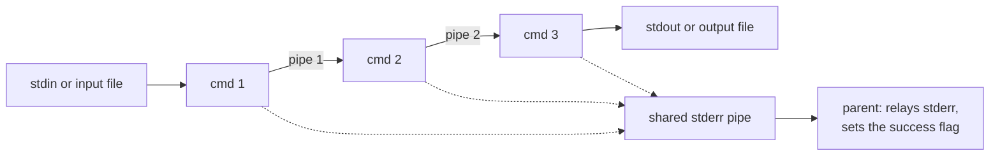
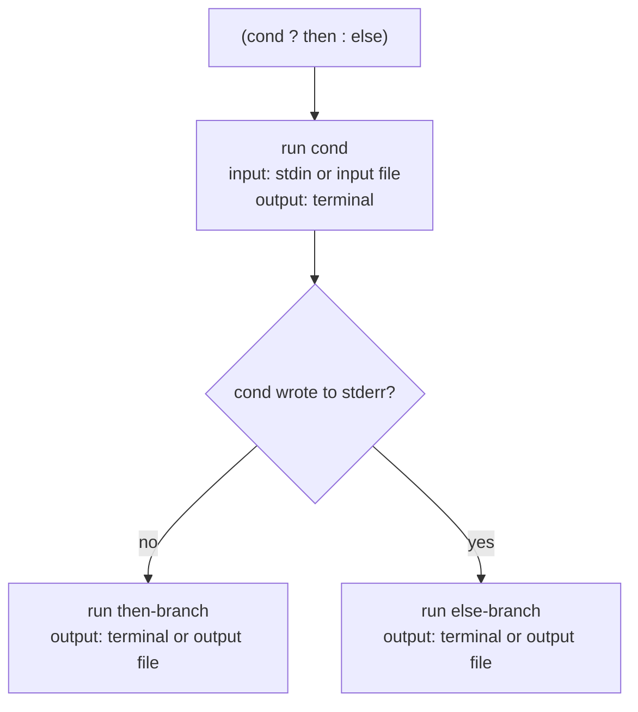

# Unix Shell in C

A small Unix shell written in C on top of `fork`, `execvp`, `pipe` and `dup2`, supporting multi-stage pipelines, `<` / `>` redirection and a nestable conditional operator `(cond ? then : else)`.

## Highlights

- **Concurrent pipelines.** An *n*-stage pipeline forks all *n* children left to right, connects them with *n − 1* pipes, and only then waits for them, so the stages run at the same time.
- **Conditional command.** `(cond ? then : else)` runs `cond` and then exactly one branch, chosen by whether `cond` wrote anything to stderr. Branches can be pipelines or further conditionals, to any depth.
- **Redirection on whole expressions.** `(cond ? then : else) < in > out` feeds the input file to the condition and sends the output file only to the branch that runs.
- **Error-stream capture.** Every stage of a pipeline writes stderr into one shared pipe; the parent reads it, relays it to the terminal and uses it as the success signal.
- **File-descriptor hygiene.** Unused pipe ends are closed in both the parent and each child, so no reader is left waiting for an EOF that never comes.

## Overview

The shell reads one line at a time, parses it into an abstract syntax tree and walks that tree. The parent process stays in control the whole time: it never forks a helper process for a conditional and only creates children for the real commands inside a pipeline. Typing `exit` (or sending EOF) leaves the shell.

### Grammar

```
Line     → "exit" | Cmd OptRedir
Cmd      → "(" Cmd "?" Cmd ":" Cmd ")" | Pipe
Pipe     → CMD ( "|" CMD )*
OptRedir → ( "<" FILE )? ( ">" FILE )?     (either order)
```

`CMD` is any program on the `PATH` with its arguments, for example `grep "cs" courses.txt`.

## Examples

`examples/` contains three small input files and seven recorded sessions in `examples/sessions/`, covering basic commands, pipes, redirection, conditionals, conditionals with pipes, nested conditionals, and conditionals with redirection. No external data is needed.

## Approach

### Pipelines



`solve_pipe` keeps the read end of the previous pipe in `lastRead`. Each child takes `lastRead` (or the pipeline's input) as stdin and the next pipe's write end (or the pipeline's output) as stdout, attaches them with `dup2`, closes the descriptors it no longer needs and calls `execvp`. After forking each child, the parent closes the write end it just handed over and the read end that is no longer needed. Once all children are started, the parent drains the shared stderr pipe and waits for every child with `waitpid`.

### Conditionals



`solve_node` is recursive: a pipeline node goes to `solve_pipe`, a conditional node runs its condition and then one branch, and a branch that is itself a conditional simply recurses. Each call returns whether anything was written to stderr, which is the value the enclosing conditional tests.

### Redirection

`main` opens the input and output files once and passes their descriptors down the tree. The input descriptor is given to the condition, so `(cat ? … : …) < file` reads the file; the output descriptor is given only to the chosen branch, so the condition's own output still goes to the terminal.

## Results

`make test` replays every recorded session through the shell and compares the output with the transcript.

| Session | Feature | Result |
|---|---|---|
| `01_basic_commands` | single commands with arguments | pass |
| `02_pipes` | two- and three-stage pipelines | pass |
| `03_redirection` | `<`, `>` and both together | pass |
| `04_conditional` | `(cond ? then : else)` | pass |
| `05_conditional_with_pipes` | pipelines inside branches | pass |
| `06_nested_conditional` | conditionals inside conditionals | pass |
| `07_conditional_with_redirection` | redirection on a whole conditional | pass |

7 of 7 sessions match their transcripts.

Session `06_nested_conditional`:

```
shell$ (cat courses.txt ? (cat courses.txt ? echo "inner ok" : echo "inner fail") : echo "outer fail")
cs
math
cs
cs
math
cs
inner ok
shell$ (cat missing.txt ? echo "outer ok" : (cat courses.txt ? echo "recovered" : echo "still bad"))
cat: missing.txt: No such file or directory
cs
math
cs
recovered
shell$ (cat missing.txt ? echo "outer ok" : (cat missing2.txt ? echo "recovered" : echo "final fail"))
cat: missing.txt: No such file or directory
cat: missing2.txt: No such file or directory
final fail
shell$ exit
Exiting shell...
```

## Key findings

- Success is decided by stderr output rather than by exit status: if any stage of the condition writes to stderr, the whole condition counts as failed.
- Keeping all control in the parent, with children only for real commands, keeps the control flow simple and makes nested conditionals fall out of plain recursion with no special cases.
- Pipeline stages run concurrently but stay coupled by the data flow: a reader waits for its writer, and a writer blocks once the pipe buffer is full.
- Closing unused pipe ends on both sides of every `fork` is essential. A single stray write end keeps the next stage waiting for EOF forever.

## Tech stack

C (POSIX: `fork`, `execvp`, `pipe`, `dup2`, `waitpid`), Make, POSIX `sh`, and the [mpc](https://github.com/orangeduck/mpc) parser-combinator library. Tested on macOS; it should build on any POSIX system with `gcc` or `clang`.

## Project structure

```
.
├── shell.c              # execution engine: pipelines, conditionals, redirection
├── parser.c, parser.h   # grammar-based command parser built on mpc
├── mpc.c, mpc.h         # mpc parser-combinator library (BSD-3)
├── Makefile
├── run_examples.sh      # replays the recorded sessions and diffs the output
└── examples/
    ├── courses.txt, input1.txt, input2.txt
    └── sessions/        # seven recorded shell sessions
```

## How to run

```sh
make                 # builds ./shell
./shell              # interactive prompt: shell$

# try the examples
cd examples && ../shell
shell$ (cat courses.txt ? grep cs courses.txt | wc -l : echo "error")

make test            # replays all sessions in examples/sessions/
make clean
```

## Credits

- `parser.c` / `parser.h` (the command parser) are third-party code.
- [mpc](https://github.com/orangeduck/mpc) by Daniel Holden, BSD-3 licensed; the license notice is kept in `mpc.h`.
- The execution engine in `shell.c` is my own work.
